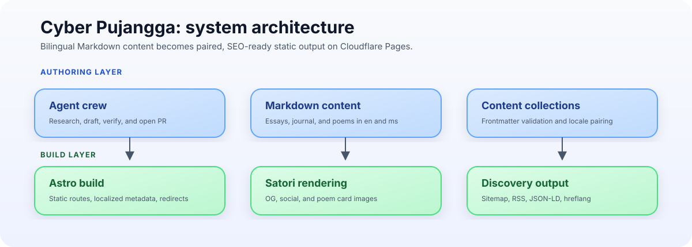

# Cyber Pujangga

[](https://cyber-pujangga.pages.dev)
[](https://astro.build)
[](https://pages.cloudflare.com)
[](https://biomejs.org)

A bilingual (English / Bahasa Melayu) home for essays, journal notes, and poems.  
Cyber Pujangga is a static Astro 7 site on Cloudflare Pages, built to keep content as ordinary
Markdown while letting agent workflows handle scaffolding, translation pairing, and deployment.

## System architecture



This design keeps the content layer plain Markdown while moving predictable outputs — redirects,
feed/canonical metadata, social images, and bilingual pairing validation — into the build layer.

## Features

- Bilingual Markdown content collections for essays, journal entries, and poems
- Language pairs across `en/` and `ms/`, including locational section slugs
- Build-time bilingual pairing validation by `pubDate` plus poem `form`
- Static social and OG image generation with Satori
- Reflow-safe strict poem cards
- Local pinning and horizontal-overflow Playwright smoke tests
- Locale-aware RSS, hreflang, `og:locale:alternate`, and JSON-LD Article metadata
- Long-lived immutable caching for hashed assets, plus baseline security headers

## Develop

```bash
cd cyber-pujangga-site
npm install
npm run dev          # http://localhost:4321
```

Requires Node `>=22.12.0`.

### Quality gates

```bash
npm run check        # content pairing + Astro types
npm run build        # content pairing + redirects + Astro build
npx biome check .    # lint/format checks (non-destructive)
npm test             # Playwright smoke tests
```

### Add content

```bash
./new-piece.sh essay my-new-essay
./new-piece.sh journal 2026-07-14-some-day
./new-piece.sh poem a-quiet-poem --lang ms
```

Content lives as `src/content/{essays,journal,poems}/{en,ms}/*.md`.  
Add or update both language counterparts when a bilingual work is intended;
`npm run check` fails unmatched pieces before Astro builds them.

## Deployment

Auto-deploy happens on pull-request merge to `master` when UI-relevant paths change:

- `src/components/**`, `src/layouts/**`, `src/styles/**`
- `public/**`
- `astro.config.ts`, `src/site.config.ts`

Content-only and script-only changes need a manual build/deploy:

```bash
./deploy.sh
```

This mirrors the neighboring `tech-journal` cleanup pipeline.

## Agentic workflow

The repository ships with shared agent entry points and a content crew:

- `AGENTS.md`, `CLAUDE.md`: conventions and commands
- `CONTEXT.md`: rationale and non-goals
- `PLAN.md`: active and completed work
- `STYLE.md`: voice guidance
- `.claude/skills`: `new-piece`, `deploy-site`, `bilingual-check`
- `.claude/workflows/weekly-content-crew.js`: research → EN/MS draft → verification → PR (never auto-merges)

## License

Personal project. Content and code are not licensed for reuse unless explicitly stated.
